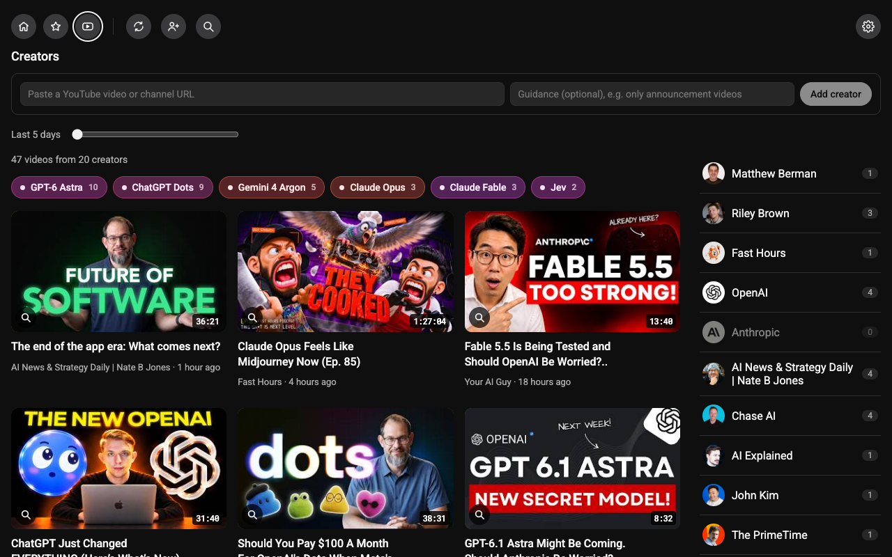

# AI News

Personal software: YouTube's subscriptions and Watch Later without the noise. A Creators page of the latest videos from a hand-picked list of channels, a Player beside it with a queue, and Favorites. Everything on it is two weeks old at most.

It is also an experiment in building without frameworks (#21): a Node server and plain HTML, JS and CSS, with no runtime dependencies and no build step. `package.json`, `server.js` and `routes.js` are the three files to read first.

## Run it

Put `YOUTUBE_API_KEY` in `.env.local` (see `.env.example`; `ANTHROPIC_API_KEY` there too is optional, for transcript summaries), then `node server.js` and open http://localhost:3000. Node 22.13 or newer; nothing to install. With no key in the environment, the app asks for it in the browser and keeps it there.

- `pnpm dev` restarts the server when a file changes.
- `pnpm install` once, then `pnpm check` (types) and `pnpm test`. Both are for working on the code, not for running it.
- Data lives in `data/` (git-ignored); `DATA_DIR` moves it. `PORT` changes the port.
- Hosting (Railway): no Dockerfile; set the key or leave it out, and mount a volume at `DATA_DIR`. One instance only: the write queue lives in memory.

## YouTube quota

The free Data API quota is 10,000 units a day and every call the app makes costs 1. Each creator's list costs 2 and is read at most twice a day (`LIST_TTL_HOURS` in `server/creators/recent.js`); video lengths are read once ever, and chapters are parsed from the descriptions the lists already carry (a video found in no list costs one unit, once). All of it is kept in `data/cache.json`, so a restart or a reload costs nothing. The server logs `[youtube] <call>: N units today` on every call, so when the quota runs out the log says what spent it.

## How TypeScript is used

Every file is plain JavaScript and runs exactly as written, in Node and in the browser. TypeScript never compiles anything here; it only reads the code and reports mistakes.

- **The shapes live in `types.d.ts`** (`Card`, `Creator`, `Settings` and the rest), written in ordinary TypeScript. They are global, so no file imports them.
- **A `.js` file points at a shape in a comment**, such as `@param {Card} card`. Most other types are inferred.
- **`pnpm check` runs the checker** over `server/`, `browser/` and `test/` (settings in `jsconfig.json`). Editors that understand TypeScript show the same errors as you type.
- **`typescript` and `@types/node` are the only packages**, and only the check needs them. Running the app needs neither.

## Status

**Focus:** empty. #17 (Player: now-playing highlight, next/previous, snap back) is the only open issue; check it is still wanted before building it, much of it may have shipped since.

**Last shipped**
- Transcript summary (#108): with the Transcript open, S shows what to take away from the video, a line and a few timestamped points; a box asks what you want from it (pre-filled with what you asked for last, #110) and Summarize has Claude (Haiku) make it from the stored transcript, kept in `data/summaries.json`; Resummarize replaces it. Needs `ANTHROPIC_API_KEY` in `.env.local`.
- X link (#91): a creator whose YouTube About page lists an X account gets the X logo on their Creators sidebar row, opening that profile; no link there, nothing shown. Read once a creator, outside the Data API's quota.
- Mini player (#93): I, while a video is in the Player, shrinks it to a small video in the lower right over Creators at full width; hover for back 10 seconds and Next; I again restores the view it left, fullscreen and Chapters included.
- Transcript (#85): queueing or playing a video asks YouTube once for its ready caption track; a green T on the History row says one is stored, and T opens it beside the video (in the normal view and while it fills the display) as readable paragraphs headed by the chapters, each timestamp seeking there; the paragraph playing is marked and scrolls to the top as the video goes (#87). Nothing is made: no track, no icon.
- YouTube's own controls work on the video again, and the keyboard comes back to the app after a click (#79). While the video fills the display, C opens Chapters as a sidebar beside it and ↑ ↓ walk them; the windowed Player fullscreens its whole page the same way (#81). Delete while full removes the video and the next plays in the normal view (#83).
- Creators' status line has a refresh link: reads every creator's list now, past the twice-a-day cache (`?fresh=1`, about 60 units).
- Collapse either half: `[` and `]` (or the ‹ › arrows on the rail) step between the left half alone, both, and the Player alone; Left and Right skip 10 seconds while the video fills the display (#76).

**Up next**
- Open issues.
